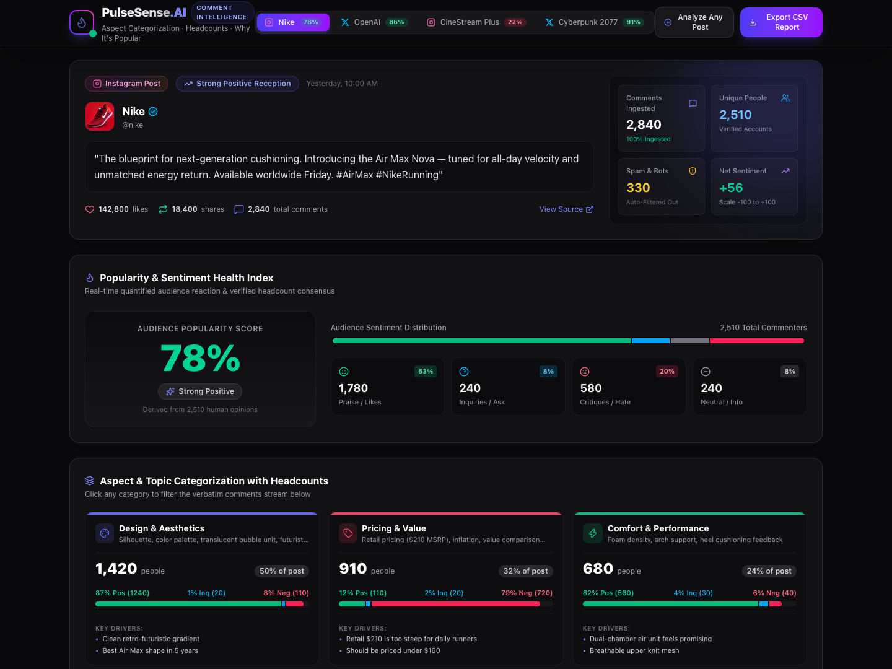
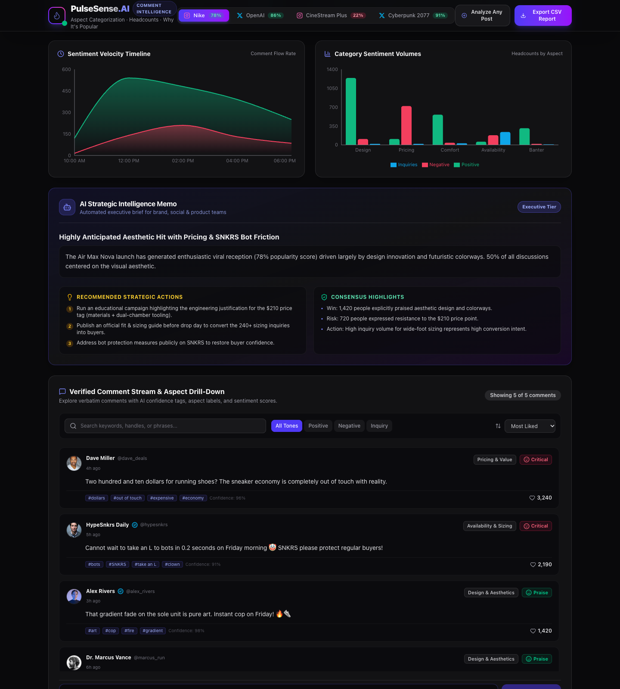
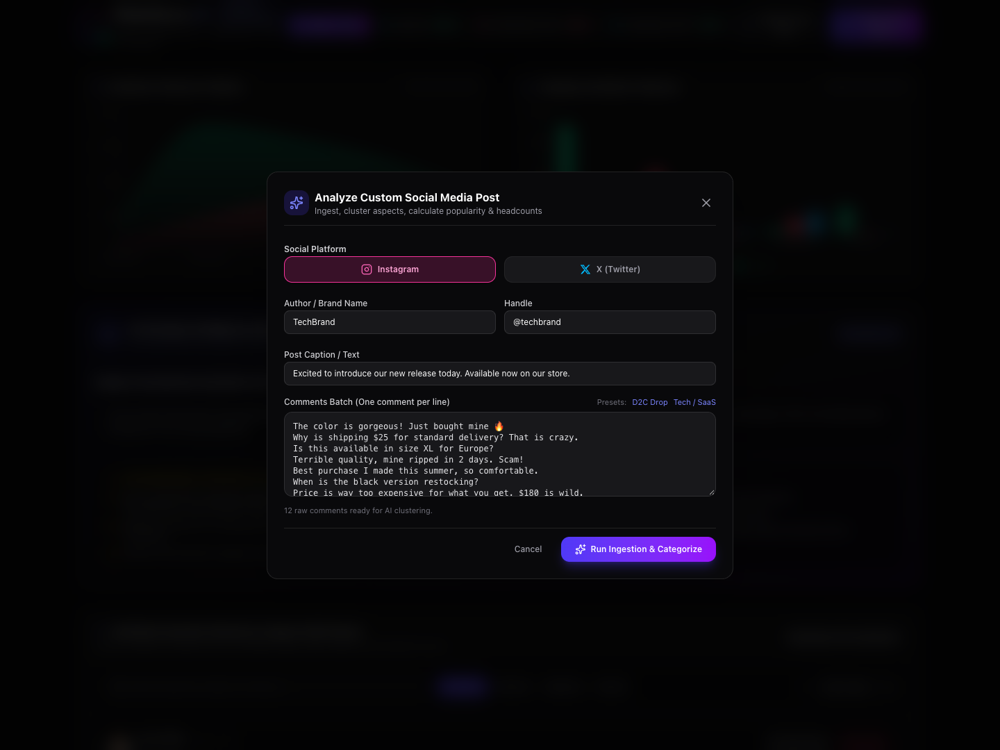
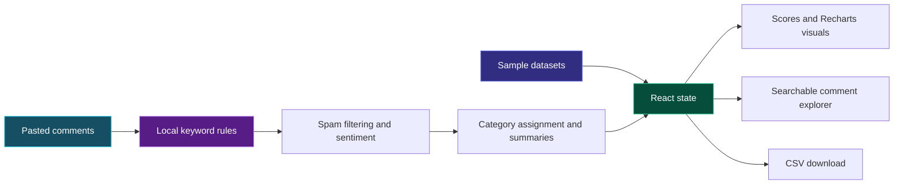

<div align="center">

# 🔥 Comment Pulse Dashboard
### PulseSense.AI · Turn comment noise into audience insight.

Explore what people love, what frustrates them, and what they want next—all in one colorful social analytics dashboard.


[Screenshots](#-inside-the-dashboard) · [Features](#-what-you-can-explore) · [Run locally](#-run-locally) · [How it works](#-how-it-works)

</div>



## 💡 The idea

A sentiment score tells you **how** an audience feels. Comment Pulse helps you explore **why**: pricing concerns, product quality, design praise, support issues, and unanswered questions.

Built as an interactive frontend prototype, it combines a dark interface with vivid sentiment colors, linked filters, visual analytics, and a searchable comment explorer. Start with the included Instagram and X sample datasets, or paste your own comments to see the dashboard update.

> **Project scope:** This is a browser-based demo with local, keyword-based analysis. It does not connect to Instagram/X APIs or use an LLM, embeddings, or a trained sentiment model. Sample data and several generated metrics are illustrative.

## ✨ What you can explore

| | Feature | What it does |
| --- | --- | --- |
| 🟢 | **Audience reception** | View popularity, net sentiment, and counts for positive, negative, neutral, and inquiry comments. |
| 🟣 | **Discussion categories** | Explore pricing, design, quality, support, questions, and humor with category-level sentiment breakdowns. |
| 🔴 | **Drivers behind the reaction** | Read praise, friction points, and representative quotes alongside an executive brief. |
| 🔵 | **Visual analytics** | Compare sentiment volumes by category and explore illustrative sentiment timelines. |
| 🔎 | **Comment explorer** | Search text, authors, and detected keywords; filter by sentiment and category; sort by likes or confidence. |
| 📝 | **Custom analysis** | Paste one comment per line, try D2C or SaaS presets, and add individual comments to recalculate the view. |
| 📥 | **CSV export** | Download the active post's sample comments with sentiment, category, likes, and detected keywords. |

## 📸 Inside the dashboard

### From trends to individual comments

Follow the charts and strategic brief down to the comment explorer to inspect the responses behind the summary.



### Try your own conversation

Choose a platform label, enter post details, and paste comments—or load a preset to get started quickly.



*Screenshots show the application running locally with demonstration data.*

## 🚀 Run locally

**Requirements:** Node.js 22.12+ and npm. No API key or database is required.

```bash
git clone https://github.com/rajashekarakula19-spec/comment-pulse-dashboard.git
cd comment-pulse-dashboard
npm ci
npm run dev
```

Open the local URL printed by Vite.

| Command | Purpose |
| --- | --- |
| `npm run dev` | Start the development server. |
| `npm run build` | Type-check and create a production bundle in `dist/`. |
| `npm run preview` | Serve the production bundle locally after building. |
| `npm run lint` | Run Oxlint. |

### A quick walkthrough

1. Switch between sample posts in the top navigation.
2. Select a sentiment or discussion category to narrow the comment explorer.
3. Click **Analyze Any Post**, choose a preset or paste comments, and run the analysis.
4. Add a comment in the explorer to see the active dataset recalculate.
5. Use **Export CSV Report** to download the active dataset's sample comments.

## 🧩 How it works



Custom input passes through the rules in [`src/utils/aiAnalyzer.ts`](src/utils/aiAnalyzer.ts). The analyzer removes matching spam, assigns sentiment and a discussion category, computes reception scores, and builds a templated summary. React state connects those results to the dashboard, filters, and export action.

### Stack and structure

| Layer | Tools |
| --- | --- |
| Interface | React 19, TypeScript |
| Styling | Tailwind CSS 4, custom CSS, Lucide icons |
| Charts and motion | Recharts, Framer Motion, Canvas Confetti |
| Tooling | Vite 8, TypeScript compiler, Oxlint |

```text
src/
├── App.tsx                 # Dataset state, filters, custom analysis, CSV export
├── components/             # Dashboard cards, charts, explorer, input modal
├── data/mockPosts.ts       # Curated social-post demonstration datasets
├── utils/aiAnalyzer.ts     # Browser-side keyword analysis and summaries
├── types/                  # Shared dataset and comment types
└── index.css               # Global styles
docs/images/                # Actual application screenshots
```

## 🔍 Understanding the demo

- **Heuristic analysis:** Keyword matching can miss sarcasm, context, and multilingual meaning. Unmatched comments default to the design category.
- **Illustrative metadata:** Custom analysis generates author identities, likes, timestamps, confidence values, and some driver metrics. These are not measured model confidence or verified platform activity.
- **Illustrative timelines:** Custom sentiment timelines are derived from final counts, rather than historical observations.
- **Session-only state:** Custom posts live in memory and reset on reload. Adding a comment recalculates from the active post's available sample comments.
- **External assets:** Avatars and some imagery use third-party URLs; README badges also require network access.

## 🛠️ Possible next steps

- Connect authorized social-platform data sources through a backend.
- Replace keyword rules with an evaluated sentiment and aspect-classification model.
- Persist datasets and use real timestamps for trend analysis.
- Add measured confidence, accessibility improvements, and automated interaction tests.

---

<div align="center">

**Built by [Rajashekar Akula](https://github.com/rajashekarakula19-spec)**

React · Data visualization · Interactive analytics

</div>
